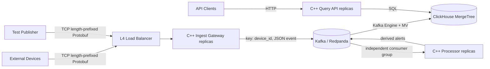

# NexStream — Master Project Document

> Version: 1.0 (2026-11-06) · Status: DESIGN BASELINE · All metrics and run commands are proposals until verified.

## Mission
Build a maintainable, scalable, C++20 distributed telemetry system demonstrating Linux networking, Protobuf serialization, Kafka streaming, ClickHouse analytics, reliability and performance engineering. Production application components are independently built, deployed and scaled.

## Scope / non-goals
- **In scope**: TCP framed telemetry input; C++ decode and validation; Kafka/Redpanda publishing; direct ClickHouse consumption via Kafka Engine and materialized view; independent analytic consumers; HTTP query API; reproducible test publisher; observability and fault testing.
- **Non-goals for V1**: full MQTT implementation, distributed consensus written from scratch, guaranteed end-to-end exactly-once, full device management, user authentication product, globally ordered events, 24/7 production SLA.

## Repositories
| Repository | Role | Runtime? |
|---|---|---|
| nexstream-contracts | Protobuf transport and telemetry event contracts | No |
| nexstream-publisher | C++20 TCP + Protobuf test and load publisher | Test only |
| nexstream-ingest | C++20 TCP/epoll gateway, decode, validate, Kafka producer, ACK coordinator | Yes |
| nexstream-processor | C++20 Kafka consumer and derived alerts | Yes, optional path |
| nexstream-query | C++20 HTTP query API backed by ClickHouse | Yes |
| nexstream-deploy | Docker Compose, infrastructure, system diagrams and runbooks | No |

## System context and critical data path

Device ACK is generated after Kafka delivery confirmation; it is **not** a ClickHouse commit ACK. Do not claim exactly-once; cross-system retries may duplicate data.

## Architecture principles
1. Six independent repos; versions pinned, no source imports from another service.
2. Clean/Hexagonal dependency rule per C++ service; avoid over-abstraction in low-level socket hot paths.
3. One service has one clear reason to change; independent build, test and rollout.
4. Schema and wire protocol are owned by Contracts repo; breaking schema updates require migration plan.
5. Bounded pending bytes, backpressure, explicit retries and failure policies across each queue boundary.
6. Visibility and failure handling are requirements, not optional polish.

## Acceptance for portfolio V1
- End-to-end verified test message: publisher -> ingest ACK -> Kafka event -> ClickHouse query.
- Documented integration run including git SHAs, build commands and actual output.
- Fault injection for Kafka outage, malformed frame, reconnect, ClickHouse outage.
- Benchmark methodology + measured p50/p95/p99, message rate, memory, CPU and success ratio.
- C4 context/container/component + architecture decisions + separate CI per C++ repo.

## Reading order
1. `01-system-architecture.md`
2. `02-message-lifecycle.md`
3. `03-ack-retry-reliability.md`
4. `10-clean-architecture.md`
5. `11-interface-contracts.md`
6. `12-engineering-standards.md`
7. `13-roadmap.md`
8. `04-startup-runbook.md` through `07-observability.md`

## Open decisions
See `14-open-decisions-and-risks.md`; nothing tagged **proposed** is a proven property or implemented feature.
