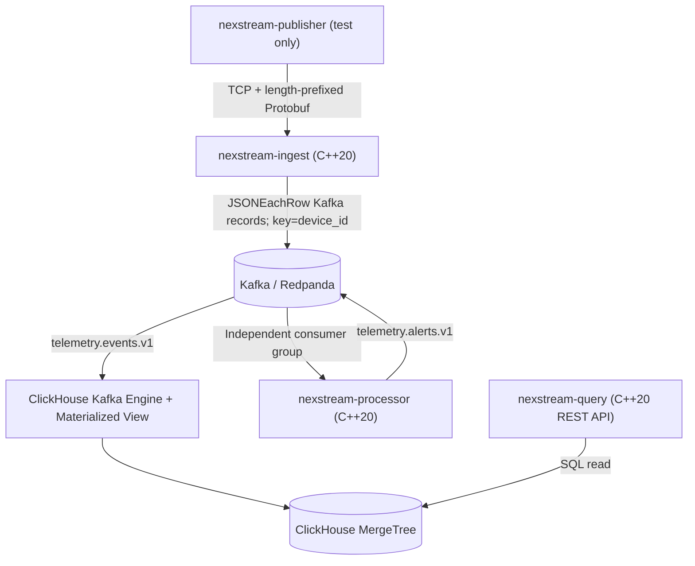

# System architecture — HLD v1.2

**State:** proposed, not production-validated.

## Repository boundaries

| Repository | Owns | Deployment |
|---|---|---|
| nexstream-publisher | traffic generation, TCP client, ACK tracking | test tool |
| nexstream-ingest | socket lifecycle, epoll, framing, decode, validation, Kafka delivery, ACK | scalable runtime |
| nexstream-processor | consume telemetry, analyze, emit alerts | scalable runtime |
| nexstream-query | HTTP endpoints, ClickHouse querying | scalable runtime |
| nexstream-contracts | Protobuf and Kafka event contracts | artifacts only |
| nexstream-deploy | Compose, ClickHouse schema, C4, monitoring, system docs | infrastructure |

## Principles

- Each runtime repo has independently built/released C++20 executable.
- Within each service: domain <- application/ports <- infrastructure adapters; `main()` wires everything.
- Kafka acknowledgement means broker accepted message, **not** stored in ClickHouse.
- Consumer-group partition count limits concurrent consumption; increasing replicas isn't automatically linear scale.
- No end-to-end exactly-once guarantee; retries can create duplicates.
- Gateways can scale horizontally behind TCP L4 balancer, which distributes **new** connections.
