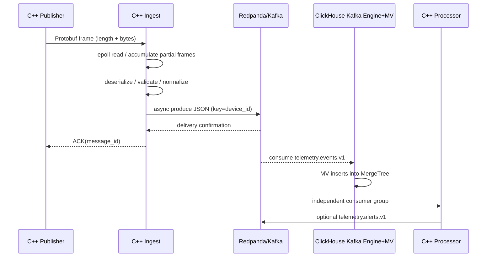

# End-to-end processing lifecycle

**State:** intended behavior. No production process has been run.



## Step-by-step

1. Publisher generates `device_id`, `message_id`, `sequence_number`, telemetry and timestamp.
2. Publisher encodes versioned Protobuf and sends a length-prefixed TCP frame.
3. Gateway accepts TCP connection, reads nonblocking; must handle fragmented headers/payloads and multiple frames per recv.
4. Frame decoder enforces maximum length **before** allocating payload buffer.
5. Protobuf adapter parses; application invokes domain validation and transforms to one JSON object per Kafka record.
6. Kafka producer publishes to `telemetry.events.v1` with key `device_id`.
7. Kafka delivery callback indicates success/failure; only after success may Gateway ACK the identified message.
8. ClickHouse independently consumes JSON records through Kafka Engine + MV into MergeTree.
9. Processor independently consumes same topic for analytics, possibly emitting alerts.
10. Query API reads persisted rows; Kafka ACK does not guarantee immediate query visibility.

## Example record (illustrative, **not the committed schema**)

```json
{"device_id":"CPE-001","message_id":"m-001","sequence_number":1,"cpu_usage":52.5,"memory_usage":61.0,"event_timestamp_ms":1793350000000,"schema_version":1}
```

## Verification evidence to collect

- [ ] Publisher sent / ACKed counters and message IDs
- [ ] Kafka record key, topic, partition, offset
- [ ] Query by message ID in ClickHouse after asynchronous ingestion
- [ ] fragmented frame and multi-frame tests
- [ ] invalid/oversized message rejection tests
